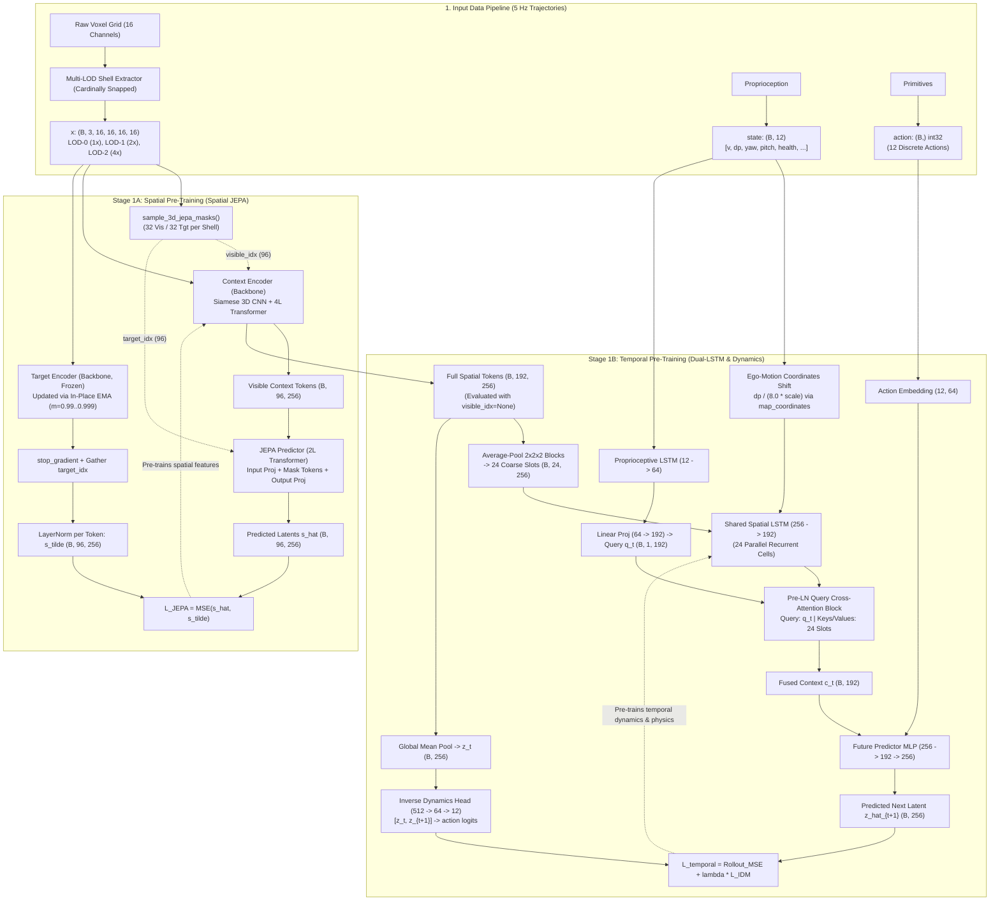
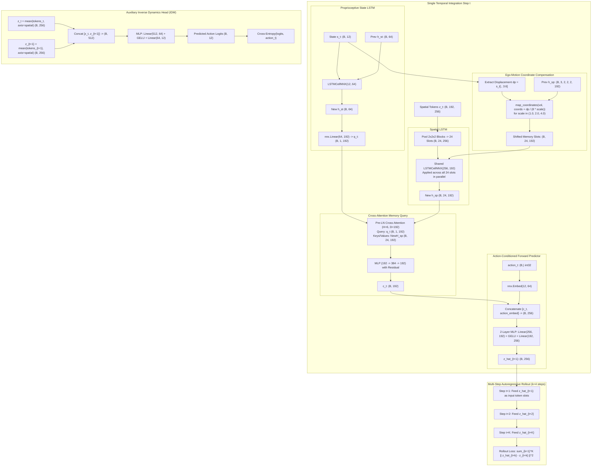
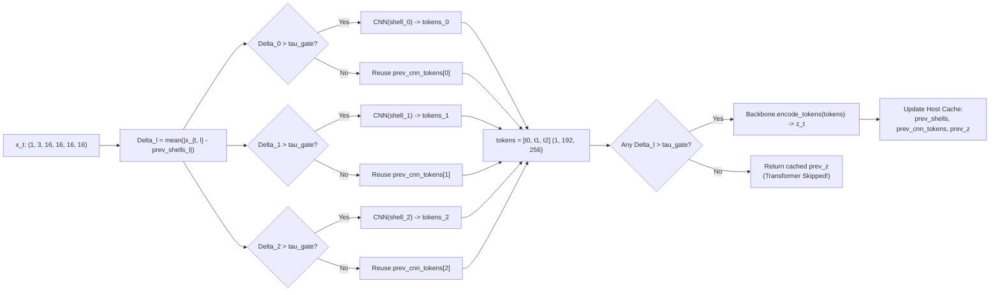

# Squared Sense — Full Pre-Training Architecture Blueprint & Specification

> **Framework**: JAX + Flax NNX (`flax.nnx`), Optax  
> **Layout**: Strictly Channel-Last `(..., X, Y, Z, C)`  
> **Core Pre-Training Paradigms**: Self-Supervised Joint-Embedding Predictive Architecture (JEPA), Ego-Motion Compensated Recurrence, and Masked Autoencoding (MAE).

---

## 1. High-Level Pre-Training Pipeline

The Squared Sense pre-training regimen splits into two complementary stages:
1. **Stage 1A — Spatial World Modeling (Spatial JEPA)**: Learns view-invariant, scale-consistent geometric representations of concentric 3D voxel shells by predicting masked spatial tokens in latent space without pixel/voxel reconstruction.
2. **Stage 1B — Temporal World Modeling (Dual-LSTM Dynamics)**: Integrates spatial representations across time with ego-motion coordinate compensation, fusing proprioceptive agent telemetry and predicting action-conditioned future latents.

---

## 2. Stage 1A: Spatial JEPA Architecture

The spatial representation learner is formulated as a **Non-generative Joint-Embedding Predictive Architecture**. It operates on concentric shells with 3D block-structured masking.

```mermaid
flowchart LR
    subgraph Inputs["Inputs"]
        X["x: (B, 3, 16, 16, 16, 16)"]
        M_vis["visible_idx: (B, 96)"]
        M_tgt["target_idx: (B, 96)"]
    end

    subgraph CtxPath["Context Path (Trainable Gradient Flow)"]
        X --> CNN_ctx["Siamese 3D ConvNeXt\nCoordConv + 2x SE Stages\n(470,944 params)"]
        CNN_ctx --> RawTokens_ctx["Tokens: (B, 192, 256)"]
        RawTokens_ctx --> AddPos_ctx["Add Spatial Embed (64, 256)\n+ Scale Embed (3, 1, 256)"]
        AddPos_ctx --> GatherVis["jnp.take_along_axis(visible_idx)"]
        M_vis -.-> GatherVis
        GatherVis --> VisTok["(B, 96, 256)"]
        VisTok --> Trans_ctx["4 x PreLNTransformerBlock(256, H=8)\n+ Final LayerNorm(256)\n(3,159,552 params)"]
        Trans_ctx --> ContextOut["u_vis: (B, 96, 256)"]
    end

    subgraph PredictorBlock["JEPA Predictor (Trainable Gradient Flow)"]
        ContextOut --> InProj["nnx.Linear(256, 192)"]
        InProj --> AddPredPosCtx["Add Pred Pos+Scale Embed"]
        
        MaskTok["mask_token: (1, 1, 192)"] --> TgtQueries["Broadcast + Add Pred Pos+Scale at target_idx"]
        M_tgt -.-> TgtQueries
        
        AddPredPosCtx --> Concat["Concatenate along Sequence Axis\n[ctx (96), queries (96)] -> (B, 192, 192)"]
        TgtQueries --> Concat
        
        Concat --> PredTrans["2 x PreLNTransformerBlock(192, H=6)\n+ Final LayerNorm(192)\n(890,112 params)"]
        PredTrans --> SliceTgt["Slice Target Positions [:, 96:, :]"]
        SliceTgt --> OutProj["nnx.Linear(192, 256)\n(49,408 params)"]
        OutProj --> PredTargets["s_hat: (B, 96, 256)"]
    end

    subgraph TargetPath["Target Path (EMA Updated, No Gradients)"]
        X --> CNN_tgt["Siamese 3D ConvNeXt\n(Target Weights)"]
        CNN_tgt --> Trans_tgt["4 x PreLNTransformerBlock(256)\n(Full 192 Tokens Evaluated)"]
        Trans_tgt --> StopG["jax.lax.stop_gradient"]
        StopG --> GatherTgt["jnp.take_along_axis(target_idx)"]
        M_tgt -.-> GatherTgt
        GatherTgt --> PerTokenNorm["Per-Token LayerNorm\n(t - mu) / sqrt(sigma^2 + eps)"]
        PerTokenNorm --> NormTargets["s_tilde: (B, 96, 256)"]
    end

    subgraph LossObjective["Optimization Objective"]
        PredTargets --> L2["L_JEPA = (1 / N_tgt) || s_hat - s_tilde ||^2"]
        NormTargets --> L2
    end
```

### 3D Masking Specification (`sample_3d_jepa_masks`)
- **Grid Structure**: $4 \times 4 \times 4$ token grid partitioned into $8$ disjoint $2 \times 2 \times 2$ blocks ($8$ tokens each).
- **Target vs. Visible**: $4$ blocks ($32$ tokens) selected as target, remaining $4$ blocks ($32$ tokens) visible per shell ($96$ vis / $96$ tgt total across 3 shells).
- **Cross-Scale Complementary Masking**: With probability $p=0.3$, target blocks in LOD-0 are kept strictly visible in LOD-1 and LOD-2, forcing the context encoder to leverage multi-scale context to resolve fine spatial detail.

---

## 3. Stage 1B: Dual-LSTM Temporal Integrator & Dynamics

Stage 1B trains temporal persistence and physics grounding across $5\text{ Hz}$ trajectory sequences.

---

## 4. Pre-Training Baselines Architecture

To rigorously ablate multi-scale concentric representation learning and self-supervised prediction targets, two baselines are implemented:

```mermaid
flowchart TD
    subgraph BaselineA["Baseline A: Single-LOD JEPA (Scale Ablation)"]
        X_single["Input Voxel Shells: (B, 3, 16, 16, 16, 16)"]
        SliceLOD["Slice Single Shell: x[:, lod_index : lod_index+1]\n(LOD-0 or LOD-2: 64 tokens)"]
        X_single --> SliceLOD
        SliceLOD --> JEPA_1Shell["SpatialJEPA(num_shells=1)\nContext Backbone: 3,647,136 params\nPredictor: 1,001,536 params\nTotal Trainable: 4,648,672 params"]
        JEPA_1Shell --> Out_single["(pred_targets, norm_ema_targets, context_tokens)"]
    end

    subgraph BaselineB["Baseline B: Generative 3D-MAE (Reconstruction Ablation)"]
        X_multi["Input Voxel Shells: (B, 3, 16, 16, 16, 16)"]
        X_multi --> Enc_mae["MultiLODBackbone(num_shells=3)\n(3,647,648 params, Visible Tokens Only)"]
        Enc_mae --> CtxTokens_mae["Visible Context Tokens: (B, 96, 256)"]
        
        CtxTokens_mae --> DecProj["nnx.Linear(256, 192)"]
        DecProj --> DecSeq["Concat [ctx_proj (96), mask_queries (96)] -> (B, 192, 192)"]
        DecSeq --> DecTrans["2 x PreLNTransformerBlock(192, H=6, mlp=4)\n+ LayerNorm(192) (890,112 params)"]
        DecTrans --> DecHead["nnx.Linear(192, 1024)\n(197,632 params)"]
        DecHead --> PredPatches["Predicted Voxel Patches: (B, 96, 1024)"]
        
        X_multi --> Patchify["patchify(x): (B, 192, 1024)\n4x4x4x16 Voxel Sub-volumes"]
        Patchify --> TgtPatches["Gather target_idx -> Ground Truth Patches (B, 96, 1024)"]
        
        PredPatches --> MAELoss["MSE Loss strictly on target patches"]
        TgtPatches --> MAELoss
    end
```

---

## 5. Event-Driven Shell Gating at Inference

During inference (and continuous deployment), identical or static shells bypass CNN evaluation via temporal difference thresholding $\tau_{\text{gate}}$.

---

## 6. Comprehensive Layer & Parameter Specification

| Module / Component | Output Tensor Shape | Trainable Parameters | Description |
| :--- | :--- | :--- | :--- |
| **Input Voxel Shells** | `(B, 3, 16, 16, 16, 16)` | $0$ | 3 concentric shells, 16 channels, float32 $[0.0, 1.0]$ |
| **CoordConv3D** | `(B, 3, 16, 16, 16, 19)` | $0$ | Normalized meshgrid $(u, v, w) \in [-1, 1]$ concatenated |
| **SiameseVoxelCNN** | `(B, 192, 256)` | $470,944$ | ConvNeXt 3D + Squeeze-and-Excitation + $1 \times 1 \times 1$ Proj |
| **Spatial Pos Embed** | `(1, 64, 256)` | $16,384$ | Learnable 3D spatial coordinate embedding |
| **Scale Pos Embed** | `(1, 3, 1, 256)` | $768$ | Learnable LOD shell scale embedding $(1\times, 2\times, 4\times)$ |
| **Backbone Transformer** | `(B, N_vis, 256)` | $3,159,552$ | 4 Pre-LN Blocks ($D=256, H=8, \text{mlp}=4$) + LayerNorm |
| **Core Backbone Subtotal** | — | **3,647,648** | Target ~3,647,264 (diff: $+384$ / $+0.01\%$) |
| **JEPA Predictor Proj In** | `(B, N_vis, 192)` | $49,344$ | Linear projection $256 \to 192$ |
| **JEPA Predictor Embeds** | `(1, 192, 192)` | $13,056$ | Mask token $(192)$ + Spatial $(12,288)$ + Scale $(576)$ |
| **JEPA Predictor Blocks** | `(B, 192, 192)` | $890,112$ | 2 Pre-LN Blocks ($D=192, H=6, \text{mlp}=4$) + LayerNorm |
| **JEPA Predictor Proj Out**| `(B, N_tgt, 256)` | $49,408$ | Linear projection $192 \to 256$ |
| **JEPA Predictor Subtotal**| — | **1,001,920** | Target ~1,001,920 (exact $0.000\%$ diff) |
| **Stage 1A Total (Encoder+Pred)** | — | **4,649,568** | Target ~4,649,184 (diff: $+384$ / $+0.008\%$) |
| **Spatial LSTM (24 slots)**| `(B, 24, 192)` | $344,832$ | Shared `LSTMCellNNX(256, 192)` across 24 slots |
| **State LSTM & Proj** | `(B, 1, 192)` | $32,192$ | `LSTMCellNNX(12, 64)` ($19,712$) + `Linear(64, 192)` ($12,480$) |
| **Query Cross-Attention** | `(B, 192)` | $297,408$ | Pre-LN Cross-MHA ($148,224$) + MLP ($148,032$) + LNs ($1,152$) |
| **Action Conditioning & MLP** | `(B, 256)` | $99,520$ | `Embed(12, 64)` ($768$) + 2L Future MLP ($98,752$) |
| **Auxiliary IDM Head** | `(B, 12)` | $33,612$ | `Linear(512, 64)` ($32,832$) + `Linear(64, 12)` ($780$) |
| **Stage 1B Integrator Total** | — | **807,564** | Target ~724,864 (including auxiliary IDM head) |
| **Baseline A (Single-LOD)**| `(B, 32, 256)` | **4,648,672** | Target ~4,648,672 (exact $0.000\%$ diff) |
| **Baseline B Decoder** | `(B, 96, 1024)` | **1,150,144** | 2L Transformer + `Linear(192, 1024)` patch head |
| **Baseline B (3D-MAE) Total**| — | **4,797,792** | Target ~5.126M (diff: $-6.4\%$, within budget) |

---

## 7. Loss Formulations & Training Objectives

### Stage 1A: Spatial JEPA Loss
$$\mathcal{L}_{\text{Spatial}} = \frac{1}{B \cdot N_{\text{tgt}}} \sum_{b=1}^B \sum_{i \in \text{target\_idx}} \|\hat{s}_{b, i} - \tilde{s}_{b, i}\|_2^2$$
where $\tilde{s}_{b, i} = \frac{s^{\text{target}}_{b, i} - \mu(s^{\text{target}}_{b, i})}{\sqrt{\sigma^2(s^{\text{target}}_{b, i}) + 10^{-6}}}$ is the per-token standardized EMA target representation, and $\hat{s}_{b, i}$ is the predictor output.  
**Target Encoder Momentum Schedule**:
$$\theta_{\text{target}} \leftarrow m \cdot \theta_{\text{target}} + (1 - m) \cdot \theta_{\text{context}}, \quad m \in [0.99, 0.999]$$

### Stage 1B: Temporal Dynamics & Auxiliary IDM Loss
$$\mathcal{L}_{\text{Temporal}} = \frac{1}{B \cdot T_{\text{valid}} \cdot K} \sum_{b=1}^B \sum_{t=1}^{T_{\text{valid}}} \sum_{k=1}^K \|\hat{z}_{b, t+k} - z_{b, t+k}\|_2^2 + \lambda_{\text{IDM}} \mathcal{L}_{\text{IDM}}$$
$$\mathcal{L}_{\text{IDM}} = \frac{1}{B (T - 1)} \sum_{b=1}^B \sum_{t=1}^{T-1} \text{CrossEntropy}\left( \text{IDM}(z_{b, t}, z_{b, t+1}), a_{b, t} \right)$$
where $z_t = \frac{1}{192} \sum_{i=1}^{192} \text{tokens}_{t, i} \in \mathbb{R}^{256}$ is the globally pooled ground-truth latent state at time $t$.

### Baseline B: 3D-MAE Voxel Patch Reconstruction Loss
$$\mathcal{L}_{\text{MAE}} = \frac{1}{B \cdot N_{\text{tgt}}} \sum_{b=1}^B \sum_{i \in \text{target\_idx}} \|\hat{p}_{b, i} - p_{b, i}\|_2^2$$
where $p_{b, i} \in \mathbb{R}^{1024}$ is the flattened $4 \times 4 \times 4 \times 16$ ground-truth voxel sub-volume patch.
